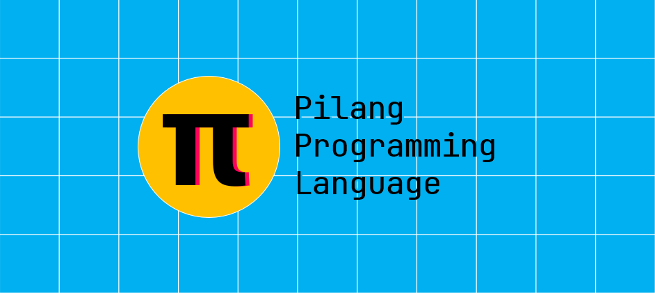
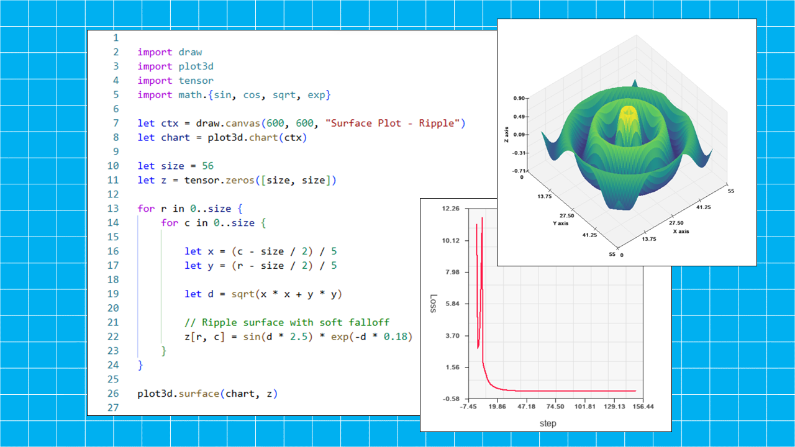
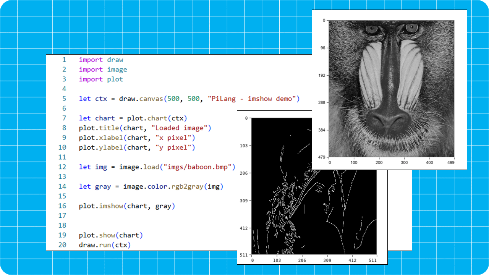
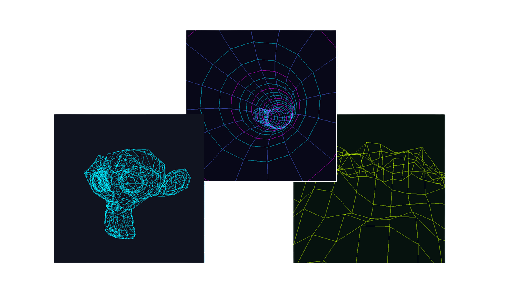
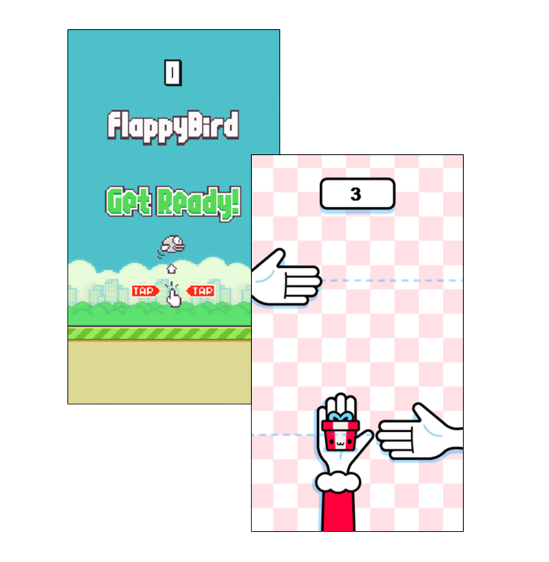
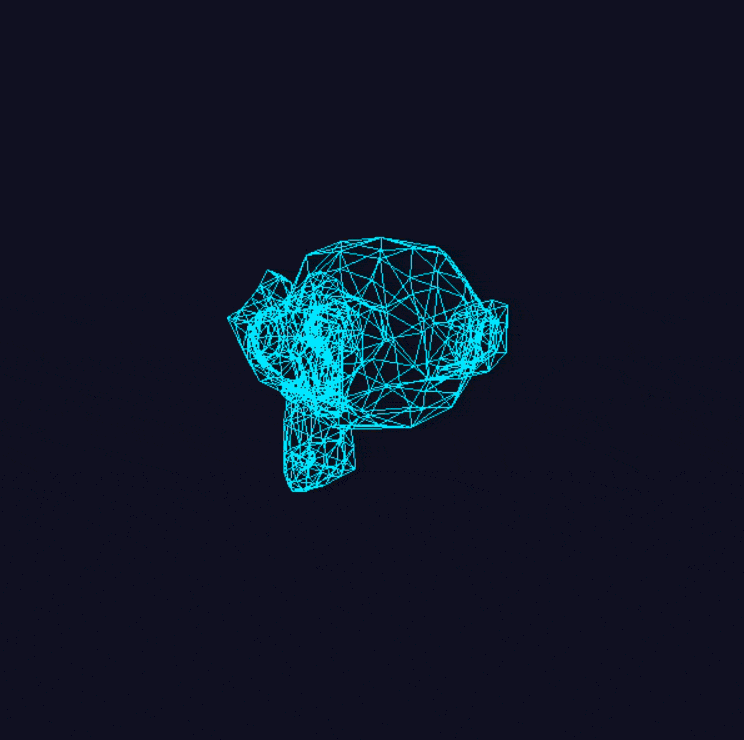

<p align="center">
  <a href="https://pi-lang.netlify.app/">
    
  </a>
</p>


<p align="center">
  A compact language for turning data, math, and ideas into visible experiments.
</p>


<p align="center">
  <a href="https://pi-lang.netlify.app/">Website</a>
  |
  <a href="docs/README.md">Read the docs</a>
  |
  <a href="samples">Explore examples</a>
</p>

## Overview

Pilang is for the moment when an idea is still small enough to explore: shape
data, run the math, and draw the result without assembling a stack of packages
first. It is a C-powered scripting language for numerical work, simulations,
visual experiments, and small interactive programs.

Tensors, image processing, 2D charts, interactive 3D plots, drawing, and audio
are available as built-in modules. Pilang runs natively on Windows and can also
be built for the browser with WebAssembly.

## Install and run

Pilang is ready to download. Get the latest **pre-release** from the
[Releases page](https://github.com/rolandbrake/pilang/releases), then choose
the archive for your platform:

- **Windows x64:** extract the ZIP and run `pilang-windows-x64\pilang.exe`.
- **Linux x64:** extract the `.tar.gz`, then run `./pilang-linux-x64/pilang`.
- **macOS:** extract the archive and open `Pilang.app` for Apple Silicon or
  Intel, as appropriate.

Pre-releases contain the newest features and are still being tested. Build
from source if you want to contribute to Pilang or work on its runtime.

To build Pilang from source, clone the repository and use the short setup path
for your platform. It installs ready-made SDL libraries; do **not** run
`make static-deps` for a normal development build.

### Windows

In PowerShell, run:

```powershell
.\tools\setup.ps1 -InstallMSYS2
```

Then open the **MSYS2 UCRT64** terminal in the repository and run:

```sh
make release
./bin/pilang.exe test.pi
```

### Linux and macOS

From the repository root, run:

```sh
sh tools/setup.sh
make release
./bin/pilang test.pi
```

### Package a Windows app

After building Pilang, add a `package.loon` beside your entry file and run:

```powershell
cd test\package
..\..\bin\pilang.exe pack target:win
```

After adding `bin/` to `PATH`, use `pilang pack target:win`. The resulting
`.exe` includes the Pilang runtime and application. A release runtime is
self-contained; a runtime built locally with MSYS2 may also need its SDL DLLs
beside the application. See [`test/package/package.loon`](test/package/package.loon)
for a complete manifest example.

```loon
name: "My App"
entry: "main.pi"
targets:
  win:
    output: "my-app.exe"
```

## Math Plotting

Turn arrays, functions, and simulations into 2D charts or interactive 3D
surface, mesh, and wireframe plots. The plotting modules are designed for quick
visual feedback while you experiment.

<p align="center">
    <a href="./samples/surface.pi">
        
    </a>
</p>

## Image Processing

Load, inspect, and transform images with built-in operations such as grayscale
conversion and edge detection, then display the result in the same script.

<p align="center">
 <a href="./samples/imshow.pi">
    
  </a>
</p>

## 3D Graphics

Explore software-projected 3D scenes, meshes, and OBJ model rendering without
leaving Pilang.

<p align="center">
  <a href="./samples/graphics/tunnel_3d.pi">
    
  </a>
</p>


## Games

Pilang supports small interactive games with drawing, input, images, and audio.
Build them for the browser with WebAssembly or package them as standalone
Windows executables. [for ready to run games](https://github.com/rolandbrake/pilang-games).

<p align="center">
  <a href="https://github.com/rolandbrake/pilang-games" target="_blank">
    
  </a>
</p>


## Quick Taste

```swift
import math:m

fun area(radius) {
    return m.PI * radius ** 2
}

radii = [2, 4, 8]

for r in radii {
    println("radius = " + r + ", area = " + area(r))
}
```

## Language Tour

### Expressive Collections

```swift
scores = [91, 72, 88, 91, 64, 72]

unique = {91, 72, 88, 64}
curved = [min(score + 5, 100) : score in scores]
honors = []

for score in curved
    if score >= 90
        honors += score

println("unique scores: " + unique)
println("honors: " + honors)
println("top three-ish: " + curved[0:3])
```

### Functions and Closures

```swift
fun make_counter(start = 0) {
    let value = start

    return () -> {
        value += 1
        return value
    }
}

next_id = make_counter(100)
println(next_id()) // 101
println(next_id()) // 102
```

### Classes, Inheritance, and Callable Objects

```swift
class Shape {
    area() {
        return 0
    }

    perimeter() {
        return 0
    }
}

class Rectangle: Shape {
    constructor(width, height) {
        this.width = width
        this.height = height
    }

    area() {
        return this.width * this.height
    }

    perimeter() {
        return 2 * (this.width + this.height)
    }

    format() {
        return "Rectangle(" +
               this.width + ", " +
               this.height + ")"
    }
}

class Circle: Shape {
    constructor(radius) {
        this.radius = radius
    }

    area() {
        return 3.14159 * this.radius * this.radius
    }

    perimeter() {
        return 2 * 3.14159 * this.radius
    }

    format() {
        return "Circle(" + this.radius + ")"
    }
}

shapes = [
    Rectangle(10, 5),
    Circle(3)
]

for shape in shapes {
    println(shape)
    println("area = " + shape.area())
    println("perimeter = " + shape.perimeter())
    println("")
}
```

### Operator Hooks

Objects can participate in operators by defining compute methods, which makes domain objects feel native without changing the VM for every new type.

```swift
import lang

class Vec2 {
    constructor(x, y) {
        this.x = x
        this.y = y
    }

    compute(op, other) {
        if op == lang.OP_ADD
            return Vec2(this.x + other.x, this.y + other.y)
    }

    format() {
        return "Vec2(" + this.x + ", " + this.y + ")"
    }
}

println(Vec2(2, 3) + Vec2(4, 1))
```

### Tensors for Numerical Code

```swift
import tensor:t

x = t.from([[1, 2], [3, 4]])
w = t.eye(2, 2)

println(t.shape(x))
println(t.matmult(x, w))
println(t.mean(x))
```

### Plotting and Visualization

Pilang includes native SDL-backed drawing and plotting modules for quick visual feedback while experimenting with numerical code, simulations, and machine-learning examples. The `plot` module covers 2D charts such as loss curves, while `plot3d` supports interactive 3D surface, mesh, and wireframe plots.

```swift
import draw
import plot

let ctx = draw.canvas(480, 480, "Training Loss")
let chart = plot.chart(ctx)

plot.line(chart, steps, losses, draw.COLOR_RED)
plot.title(chart, "Training Loss")
plot.xlabel(chart, "step")
plot.ylabel(chart, "loss")
plot.grid(chart, true)

plot.show(chart)
draw.run(ctx)
```


## Run Pilang

Run a script from the repository root:

```sh
./bin/pilang test.pi
```

On Windows, use:

```powershell
.\bin\pilang.exe test.pi
```

### Build a `.px` project

Turn an entry script and its imported Pilang modules into a portable compiled
project file:

```sh
./bin/pilang build app.pi
./bin/pilang app.px
```

This creates `app.px` beside `app.pi`. A `.px` contains Pilang bytecode and is
run by the Pilang runtime; it is not a standalone Windows `.exe`. When an
adjacent `.px` is valid, normal source execution uses it automatically and
rebuilds it when a source module changes. See the
[PX project format](docs/12.%20Advanced%20Topics/12.6-px-file-format.md) for
details.

Show available commands:

```sh
./bin/pilang help
```

Developer helpers:

```sh
./bin/pilang dis test.pi
./bin/pilang dis -o bytecode.txt test.pi
./bin/pilang fmt test.pi
./bin/pilang min test.pi
```

`fmt` and `min` rewrite the target file in place and use the JavaScript utilities in `utils/`, so Node.js and the formatter/minifier modules must be available.

## Browser build

Build the WebAssembly version after installing Emscripten:

```sh
make web
```

This writes `pilang.html`, `pilang.js`, and `pilang.wasm` to `bin/`.

Other useful targets:

- `make debug`: build a debug executable in `bin/`.
- `make test`: build and run the test suite.
- `make clean`: remove generated build outputs.

Run the end-to-end benchmark suite after a release build:

```powershell
python tools/run_benchmarks.py
```

See [`benchmark/README.md`](benchmark/README.md) for the included workloads and runner options.

## Project Layout

- `pi_*.c`, `pi_*.h`: core compiler, parser, VM, values, objects, modules, and runtime internals.
- `builtin/`: built-in native modules.
- `libs/`: Pilang libraries written in `.pi`.
- `ML/`: numerical and machine-learning experiments written in Pilang.
- `release/`: local build outputs.
- `benchmark/`: end-to-end interpreter benchmark programs.
- `docs/`: language documentation and reference material.
- `tests/`: examples and regression tests grouped by language area.

## Documentation

Start with the [documentation index](docs/README.md), then explore:

- [Language features](docs/1.%20Introduction/1.2-features.md)
- [Running Pilang](docs/1.%20Introduction/1.4-running-pilang.md)
- [Data types](docs/3.%20Data%20Types/README.md)
- [Functions](docs/6.%20Functions/README.md)
- [Objects and classes](docs/7.%20Objects%20and%20Classes/README.md)
- [Modules](docs/8.%20Modules/README.md)
- [Audio](docs/8.%20Modules/8.4%20Built-in%20Modules/audio.md)
- [2D plotting](docs/8.%20Modules/8.4%20Built-in%20Modules/plot.md)
- [3D plotting](docs/8.%20Modules/8.4%20Built-in%20Modules/plot3d.md)
- [Image processing](docs/8.%20Modules/8.4%20Built-in%20Modules/image.md)
- [Examples](docs/13.%20Examples/README.md)

## Testing

Run the test suite with:

```bash
python tools/run_tests.py
```

Tests cover core language behavior, tensors, modules, object/class behavior, runtime types, built-ins, and larger example programs.

## Website

The language website and playground are available at:

**https://pi-lang.netlify.app/**

Use it to read docs, browse examples, and try Pilang in the browser.

<p align="center">
    <a href="./samples/graphics/monkey_3d.pi">
        
    </a>
</p>

## License

This project is licensed under the terms in [LICENSE](LICENSE).


